# Cross-Cohort Transcriptomic Signatures of Osimertinib Resistance in EGFR-Mutant NSCLC Cell Lines

A leakage-controlled, cross-dataset bulk RNA-seq and machine-learning study

## Abstract

Acquired resistance to third-generation EGFR tyrosine kinase inhibitors, such as osimertinib, is the dominant cause of treatment failure in EGFR-mutant non-small cell lung cancer (NSCLC). This study derived, validated, and interpreted a transcriptional signature of acquired osimertinib resistance using bulk RNA-seq of EGFR-mutant lung adenocarcinoma cell lines. Two public GEO cohorts were paired: a discovery series (GSE202859; parental vs chronically resistant "-OR" lines) and an independent validation series (GSE193258; DMSO vehicle vs 3-week drug-tolerant persisters), both restricted to the three shared cell lines PC9, H1975, and HCC827, with 9 sensitive and 9 resistant samples each. Counts from the uniformly reprocessed NCBI pipeline were variance-stabilised, and differential expression was tested with DESeq2 using a ~ cell_line + condition design. A cross-dataset validated signature of 1,112 genes (significant and directionally consistent in both cohorts) was characterised by over-representation analysis (GO-BP, KEGG, Reactome) and pre-ranked GSEA, cross-checked with the R fgsea engine (NES concordance rho = 0.70-0.86). Group-aware nested cross-validation across logistic regression, random forest, SVM, and XGBoost supported a pre-registered primary configuration (logistic regression, K = 50), which generalised one-shot to the independent cohort (ROC-AUC 1.000, 95% CI 1.000-1.000; sensitivity 1.000, specificity 0.444 under the strict headline scheme). A composite stability, selection-frequency, and SHAP score produced a 100-gene candidate biomarker panel. Locked models recovered a drug-withdrawal gradient on an excluded time-course arm (transductive P(Resistant): DMSO 0.05 to DTP 0.80, washout samples between anchors), consistent with partial biological reversibility. All findings are exploratory candidate-biomarker discoveries on three shared cell lines; no clinical, diagnostic, or causal claims are made.

## Introduction

Third-generation EGFR TKIs such as osimertinib have substantially improved outcomes in EGFR-mutant NSCLC, yet nearly all patients eventually progress through acquired, largely non-genetic resistance mechanisms. Transcriptomic profiling of experimentally derived resistant derivatives offers a controlled system to study these non-genetic states; however, single-cohort analyses are prone to batch effects, dataset-specific artefacts, and optimistic classification performance. A rigorous design therefore requires: (a) independent discovery and validation cohorts with a shared gene universe and harmonised processing; (b) differential-abundance methods that control for genetic background; (c) biological characterisation of the shared signature; and (d) predictive models whose validation is statistically honest, leakage-controlled, and evaluated once, after the models are locked.

This report presents the full pipeline used to build and validate such an analysis on two GEO cohorts, the discovery series GSE202859 and the validation series GSE193258, covering preprocessing, differential expression, cross-dataset signature validation, functional enrichment, machine-learning classification with group-aware nested cross-validation and one-shot external validation, biomarker prioritisation, and a drug-withdrawal reversibility experiment. The code base, configuration, and outputs are reproducible from a git-committed repository.

The research objectives were:

1. Derive the set of differentially expressed genes (resistant vs sensitive) per cohort, with background genotype (cell line) statistically controlled.
2. Identify the cross-dataset consistent core signature of acquired osimertinib resistance.
3. Characterise the signature biologically (over-representation and GSEA) and probe its robustness with a second GSEA engine.
4. Evaluate whether the signature discriminates resistant from sensitive states in a held-out cohort using leakage-safe machine learning under a pre-registered primary configuration, with uncertainty quantified.
5. Prioritise a candidate biomarker panel and probe biological reversibility of the learned signal on an excluded drug-withdrawal arm.

## Literature Review

**Osimertinib and acquired resistance.** Osimertinib is a covalent third-generation EGFR TKI active against sensitising EGFR mutations and the gatekeeper-resistant T790M mutation, and the standard first-line treatment for EGFR-mutant advanced NSCLC. Clinically, disease progression eventually occurs in virtually all treated patients, driven by primary or secondary resistance mechanisms (Blaquier et al., 2023). Beyond on-target EGFR second-site mutations and bypass activations, much of the resistance is non-genetic: chromatin-remodelling states, drug-tolerant persister (DTP) phenotypes, and lineage plasticity. de Miguel et al. (2023) showed that mammalian SWI/SNF (mSWI/SNF, BAF) chromatin remodelling complexes, and specifically the SMARCA4/SMARCA2 ATPases, support osimertinib resistance through chromatin-accessibility rewiring of cell-proliferation, EMT, epithelial-differentiation, and NRF2 oxidative-stress programs; genetic or pharmacologic disruption of these ATPases re-sensitises a subset of resistant models. This motivates a transcriptomic, pathway-level framing of resistance rather than a purely mutational one.

**DTP states and reversibility.** Criscione et al. (2022) profiled osimertinib DTPs (500 nM, 21 days) across EGFR-mutant NSCLC lines with RNA-seq, ChIP-seq, and ATAC-seq, and showed that DTPs carry a distinct transcriptional-epigenomic state apart from cell-cycle effects, with therapeutic vulnerabilities (MEK, TEAD, AURKB, BRD4). Persister states are at least partially reversible after drug withdrawal, which motivates washout time-courses: if the resistance signal decays with drug removal, the phenotype is state-like rather than mutation-like. Acute-exposure and washout arms provide that design; these states confound the primary Sensitive-vs-Resistant contrast and must be excluded from label-bearing contrasts while remaining valuable for sensitivity probes, which is the policy adopted in this pipeline.

**Public RNA-seq resource design.** GEO hosts NCBI-uniformly reprocessed RNA-seq count matrices (HISAT2 and featureCounts against GRCh38.p13 in Entrez gene space) produced by an identical pipeline for arbitrary GEO-deposited studies (Barrett et al., 2013). Two independent series can therefore be analysed with identical alignment and annotation, removing inter-study batch and gene-ID discrepancies that would otherwise mask cross-dataset reproducibility. Manual subsetting based on sample titles and metadata yields matched cohorts without cross-batch confounding.

**Differential expression with multi-factor designs.** DESeq2's negative-binomial generalised linear model supports covariate-adjusted contrasts (~ cell_line + condition; Love et al., 2014) that absorb the three genetic backgrounds into a blocking factor while estimating the condition effect on all 18 samples per cohort, a design that increases power versus per-line analyses and guards against line-driven spurious calls. Its variance-stabilising transformation (VST) yields a scale-free expression matrix suitable for classification and cross-cohort transfer.

**Enrichment analysis and engines.** Over-representation analysis (hypergeometric test with Benjamini-Hochberg FDR) requires an explicit reference universe; using all genes annotated in the gene-set source is the conservative, transparent choice adopted here (decision D10). ORA over discretised DEG lists is complemented by pre-ranked GSEA (Subramanian et al., 2005), which scores whole ranked transcriptomes without dichotomisation, with Reactome (Gillespie et al., 2022), KEGG (Kanehisa and Furumichi, 2017), and GO-BP gene sets from the Enrichr collection (Kuleshov et al., 2016). Python pre-ranked GSEA approximates the permutation null, while R fgsea (Korotkevich et al., 2019) computes an exact multilevel estimate, so a two-engine concordance check is the recommended robustness layer.

**Machine learning on small, structured genomic data.** With 18 samples spanning only three genetic backgrounds, cross-validation must be group-aware: splitting by cell line (all replicates of a line inside one fold) prevents same-line leakage and yields a realistic, if pessimistic, estimate of cross-genotype generalisation. Hyperparameter tuning and feature selection must occur strictly inside training folds; nested cross-validation is the accepted control for selection bias and the winner's curse (Varma and Simon, 2006). Interpretable linear models remain a strong baseline in small-n genomic settings, complemented by tree ensembles and margin-based classifiers. External validation on a fully independent cohort, run once after model lock, is the gold standard for claims that go beyond within-cohort exploratory fits.

## Methodology

### Cohorts and labels

Two bulk-RNA-seq series were selected to maximise biological comparability (Table 1). Both profile the same three human lung adenocarcinoma cell lines (PC9, H1975, HCC827) and both have NCBI-uniform raw count matrices, ensuring a shared gene universe. Labelled endpoints are 9 Sensitive (parental / DMSO) versus 9 Resistant (-OR / osi_DTP) per cohort. Additional samples, acute osimertinib treatments and SMARCA4-shRNA perturbation arms in GSE202859, and the acute/washout timecourse and the non-shared line HCC2935 in GSE193258, are excluded by policy from the label-bearing contrast and tracked with explicit reasons in coldata_all.csv (52 and 60 samples respectively, of which 18 are kept per cohort). The -OR endpoint (chronically dosed parental to resistant derivative) and the osi_DTP endpoint (3-week 500 nM persister state) differ by design and are treated as a distribution shift to be handled and disclosed, not hidden.

**Table 1. Cohort selection.**

| Item | Discovery (GSE202859) | Validation (GSE193258) |
|---|---|---|
| System | EGFR-mutant lung adenocarcinoma cell lines | Same |
| Drug context | Chronically dosed osimertinib-resistant (-OR) vs parental | 3-week 500 nM osimertinib DTP vs DMSO vehicle |
| Platform | Illumina NovaSeq 6000 | Illumina HiSeq 4000 |
| Samples used | 18 (9 S / 9 R) | 18 (9 S / 9 R) |
| Samples excluded | 34 (acute treatment; shRNA arms; PC9-OR untreated controls) | 42 (24 h acute; short and long washout; HCC2935 line) |
| Primary paper | de Miguel et al. (2023), Cancer Cell, PMID 37541244 | Criscione et al. (2022), npj Precision Oncology, PMID 36575215 |

### Preprocessing and differential expression

For each cohort, the NCBI raw count matrix (GRCh38.p13, Entrez GeneIDs) was loaded, mapped to gene symbols using Homo_sapiens.gene_info (non-resolvable mappings discarded, duplicate-symbol collapses logged), filtered at min_count = 10, and normalised with DESeq2 as the primary method (limma/OLS retained only as declared fallbacks and not used). Differential expression was fitted with the design ~ cell_line + condition, so the condition contrast is adjusted for genetic background. Genes with Benjamini-Hochberg FDR < 0.05 and |log2 fold change| > 1 were called significant. The DESeq2 variance-stabilising transform produced the expression matrix used by the machine-learning track. Library composition was uniform across cohorts (23,585 genes consistently detected in GSE202859; 25,823 in GSE193258), with per-sample library sizes of roughly 19.6-37.6 million reads (GSE202859) and 20.2-50.8 million (GSE193258). PCA of the VST matrix (Figures 1-2) and sample-to-sample correlation matrices (Figures 3-4) confirmed that the three replicates per cell line and condition cluster coherently in both cohorts.

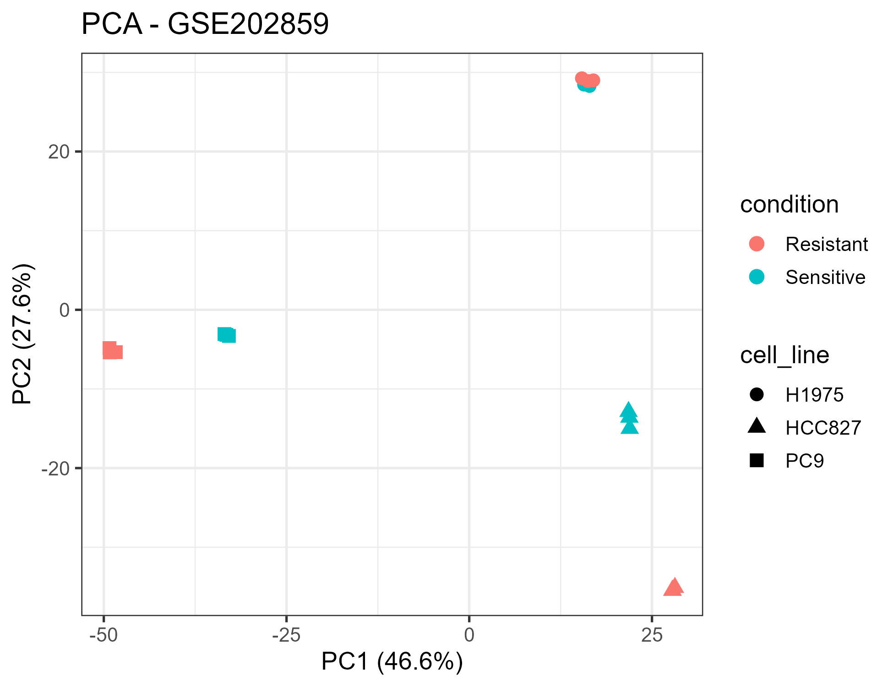

*Figure 1. PCA of the VST-normalised expression matrix — discovery cohort GSE202859.*

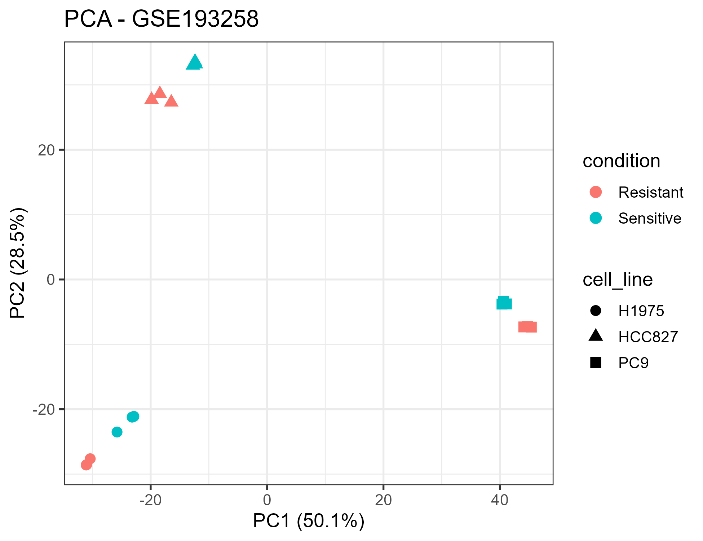

*Figure 2. PCA of the VST-normalised expression matrix — validation cohort GSE193258.*

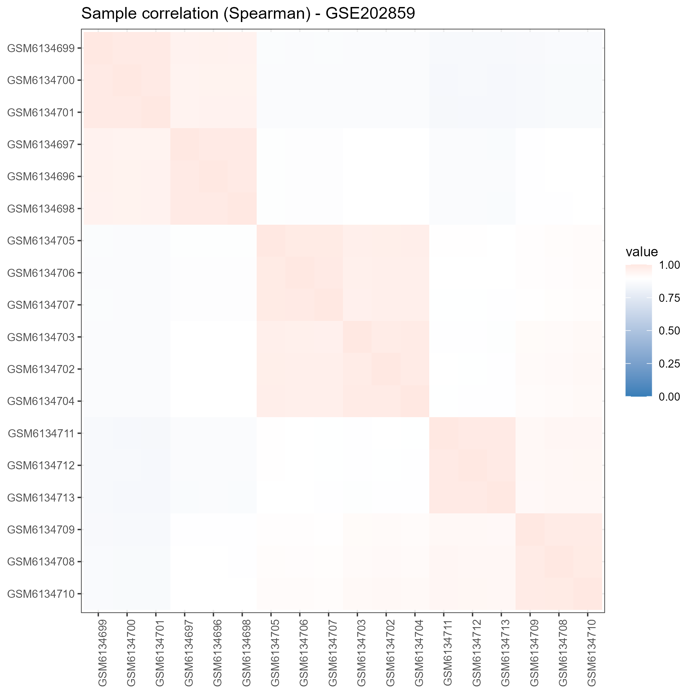

*Figure 3. Sample correlation — discovery cohort GSE202859.*

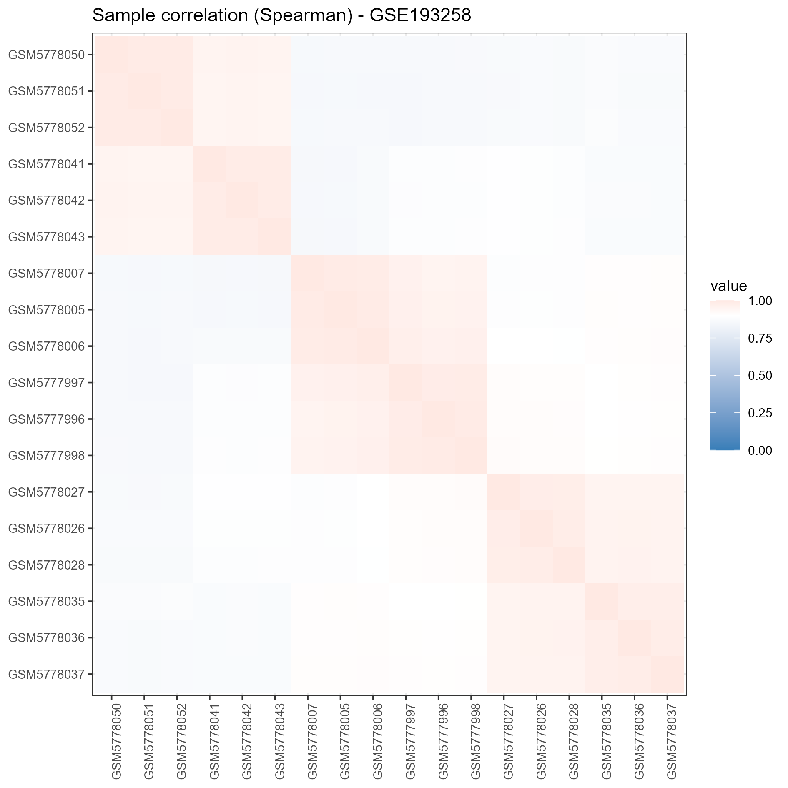

*Figure 4. Sample correlation — validation cohort GSE193258.*

### Cross-cohort signature validation

The validated signature requires a gene to be significant in both cohorts with the same direction of effect. From 2,785 significant discovery genes (1,435 up, 1,350 down) and 4,852 significant validation genes (3,651 up, 1,201 down), 1,273 genes were significant in both, of which 1,112 were directionally consistent (161 flipped sign). Per-cohort-only sets were also sizeable (discovery-only 1,512; validation-only 3,579), decomposed in an UpSet-style figure (Figure 9).

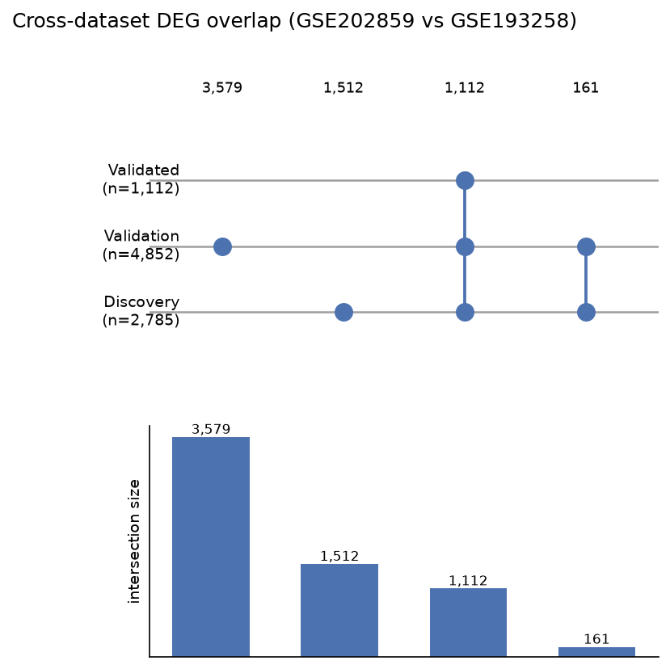

*Figure 9. UpSet-style decomposition of the cross-cohort DEG overlap.*

### Functional enrichment

Over-representation was computed in Python (hypergeometric + BH FDR) over the validated signature and per cohort, with the per-source annotated universe as background (all genes present in that source's gene-set collection; decision D10), spanning GO Biological Process (Enrichr GMT, symbol-based), KEGG, and Reactome (public Entrez sources converted to symbols). Pre-ranked GSEA on the DESeq2 signed log2FC ranking was run as the primary engine, and R fgsea (exact multilevel algorithm) as a paired cross-check on identically exported GMT files, with concordance reported per cohort and collection.

### Machine learning with group-aware nested CV

The ML track used the VST matrix with the validated 1,112-gene signature as the candidate feature pool. For each model family (Logistic Regression, Random Forest, SVM, XGBoost) and each feature-set size K in {10, 20, 50, 100, 200, 500}, a group-aware nested cross-validation was run: StratifiedGroupKFold with groups = cell_line (all replicates of one line always in the same fold); feature selection, scaling, and hyperparameter tuning performed strictly inside each training fold (inner grouped GridSearchCV); the winning inner configuration refit on the outer-training fold and evaluated on the untouched outer fold; out-of-fold predictions and metrics (ROC-AUC, PR-AUC, sensitivity, specificity, F1) logged per (model, K), each carrying a stratified bootstrap 95% confidence interval. All 24 model-K cells per cohort were reported, the full result surface rather than a cherry-picked best cell.

The primary configuration was pre-registered before external validation: Logistic Regression, K = 50 (decision D2). External validation ran once, with locked-cohort discipline enforced: no model or threshold change was permitted after the external table was read. Two scoring schemes appear throughout: train_stats (headline scheme, decision D1), where scalers and K-best selection are estimated on the discovery cohort only, the honest generalisation estimate; and target_z (transductive bound only), z-scored against the validation cohort's own statistics, which leaks test-set marginal information and is reported exclusively as an optimistic upper bound.

A washout-sensitivity arm refitted VST once, blind, on all 60 available GSE193258 samples (the primary labelled matrix untouched), and applied the locked discovery models (persisted per decision D9) to the excluded timecourse arm (osi_acute, short washout, long washout at 72 h, 96 h, 7 d, 10 d, plus DTP and DMSO anchors). This is a label-free reversibility probe, not an accuracy claim (decision D7).

### Interpretation, biomarker ranking, and reproducibility controls

Per-model explanations (L1 coefficient paths, mean |SHAP| value, permutation importance) were computed on the discovery cohort and combined into one composite panel score: a rank-average of resampling stability, nested-CV selection frequency, and mean |SHAP|. The top 100 composite-ranked genes are reported as a candidate panel.

The pipeline re-runs end-to-end with a fixed seed (42) recorded centrally in config/config.yaml. By-design controls: cohorts kept separate with no pooled cross-validation; group-aware splits with feature selection and scaling entirely inside folds; external validation evaluated once after model lock; an explicit, logged enrichment universe (decision D10); the full result surface reported, with SVM decision-function scores flagged as monotone sigmoids rather than calibrated probabilities; and persisted model artefacts for every configuration (decision D9). All decisions (D1-D14) are recorded with rationale in the decision log, with a leakage checklist in the configuration directory.

## Analysis

### Cross-cohort reproducibility of DEGs

DESeq2 found 2,785 significant genes (1,435 up, 1,350 down) in the discovery cohort and 4,852 (3,651 up, 1,201 down) in the validation cohort (volcano plots, Figures 5-6; top-DEG heatmap, Figure 7). Directional consistency is strong: 1,112 of the 1,273 genes significant in both cohorts carry the same direction, while 161 flip sign, mostly weaker cohort-specific responses; per-cohort-only sets were also sizeable (discovery-only 1,512; validation-only 3,579). The cross-dataset log2FC concordance plot (Figure 8) shows that effect sizes, not just directions, agree between cohorts along the aligned diagonal. The bulk of the persistent resistance signal is therefore shared across independently produced studies, evidence that the signature reflects the resistance state rather than a dataset artefact.

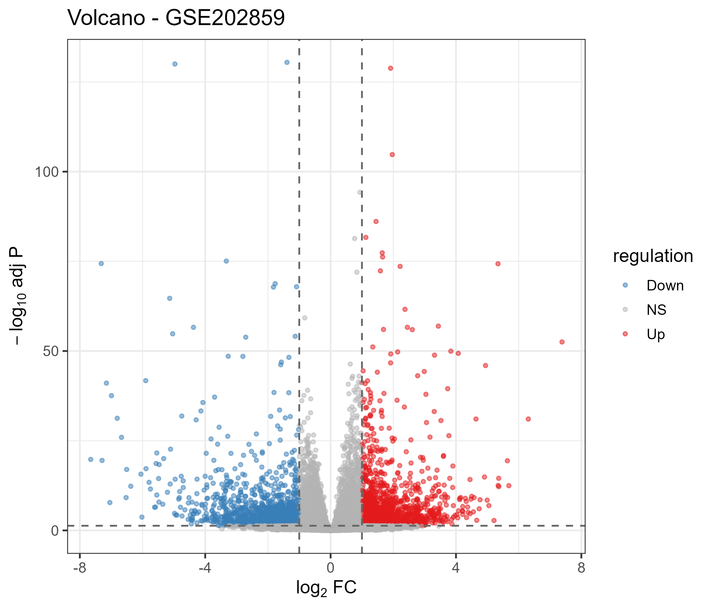

*Figure 5. Volcano plot — discovery cohort GSE202859.*

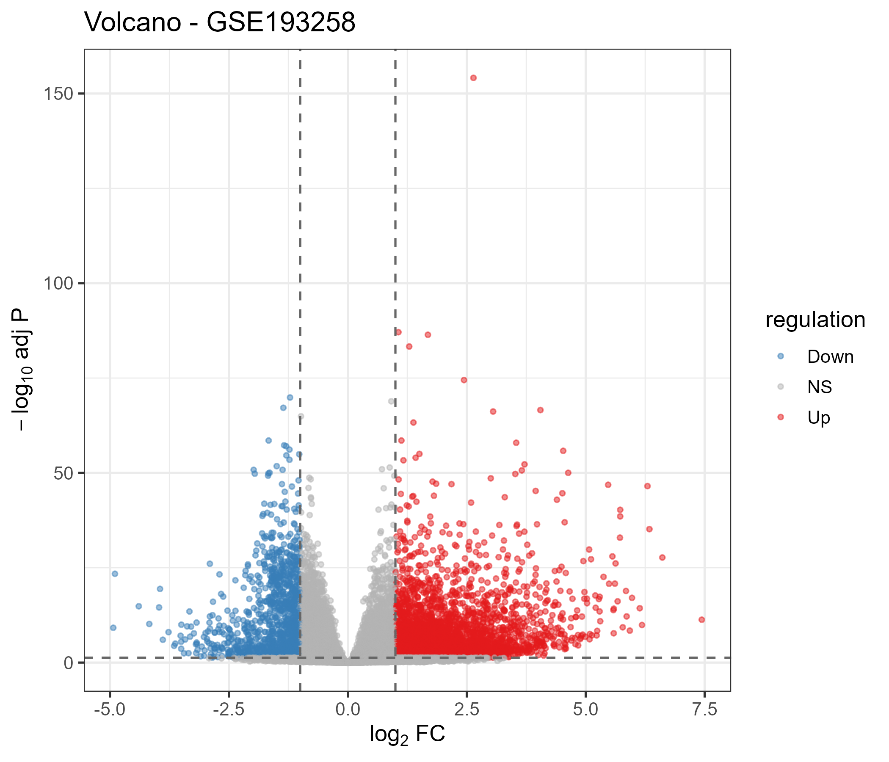

*Figure 6. Volcano plot — validation cohort GSE193258.*

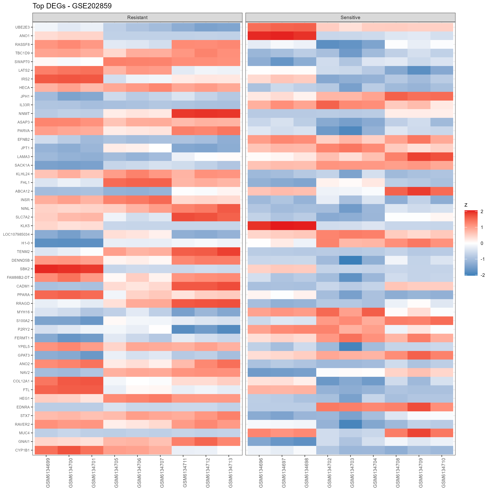

*Figure 7. Top-DEG heatmap — discovery cohort GSE202859.*

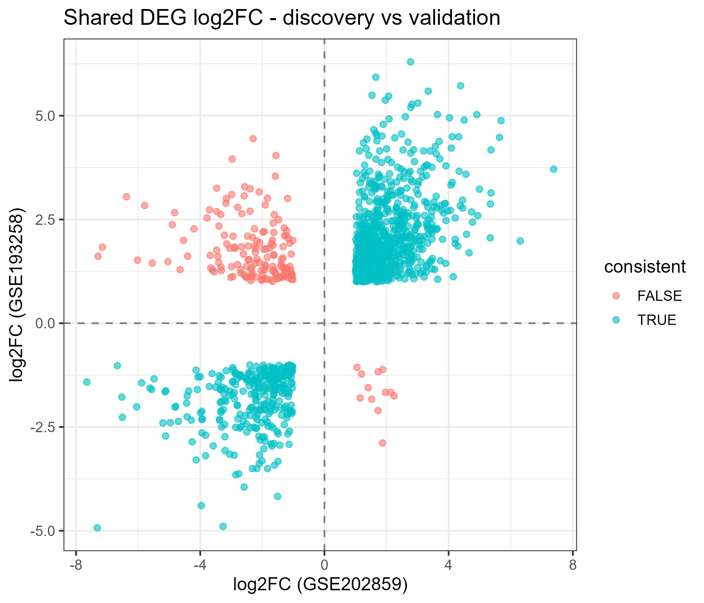

*Figure 8. Cross-dataset log2FC concordance — validation vs discovery.*

### Biological characterisation of the validated signature

Over-representation of the 1,112-gene validated signature (conservative per-source annotated background) yielded coherent themes. In GO Biological Process, up-regulated terms are dominated by movement and remodelling programs, regulation of cell migration (40/434 genes, fold enrichment 2.05, padj 0.026), extracellular matrix organisation (20/176, FE 2.53), axonogenesis and neuron projection guidance (developmental morphogenesis programs), and transport programs (transport across blood-brain barrier, FE 3.41; carboxylic acid transport, FE 4.20). In KEGG, cytoskeleton in muscle cells (23/233, FE 2.48, padj 0.016) and Hippo signalling (16/157) recur, cytoskeletal plasticity and the Hippo/YAP axis being established features of persister biology, while complement and coagulation cascades (11/89) reflect an inflammatory/remodelling component. In Reactome, developmental cell lineages (27/181, padj < 0.001), mammary gland myoepithelial lineage, cell-surface interactions at the vascular wall, ECM organisation (33/321), and O-linked glycosylation converge with GO on lineage plasticity and surface/ECM remodelling.

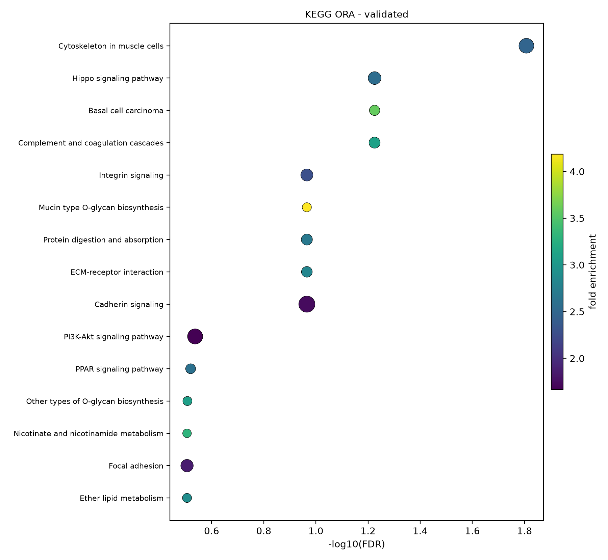

*Figure 10. ORA dot plot — validated signature, GO Biological Process.*

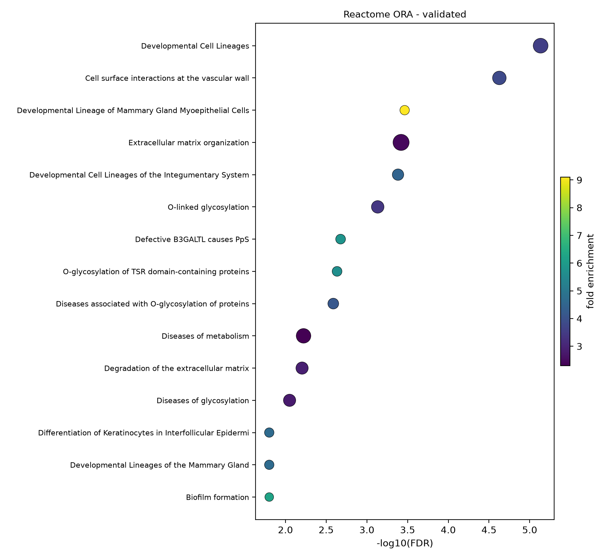

*Figure 11. ORA dot plot — validated signature, KEGG.*

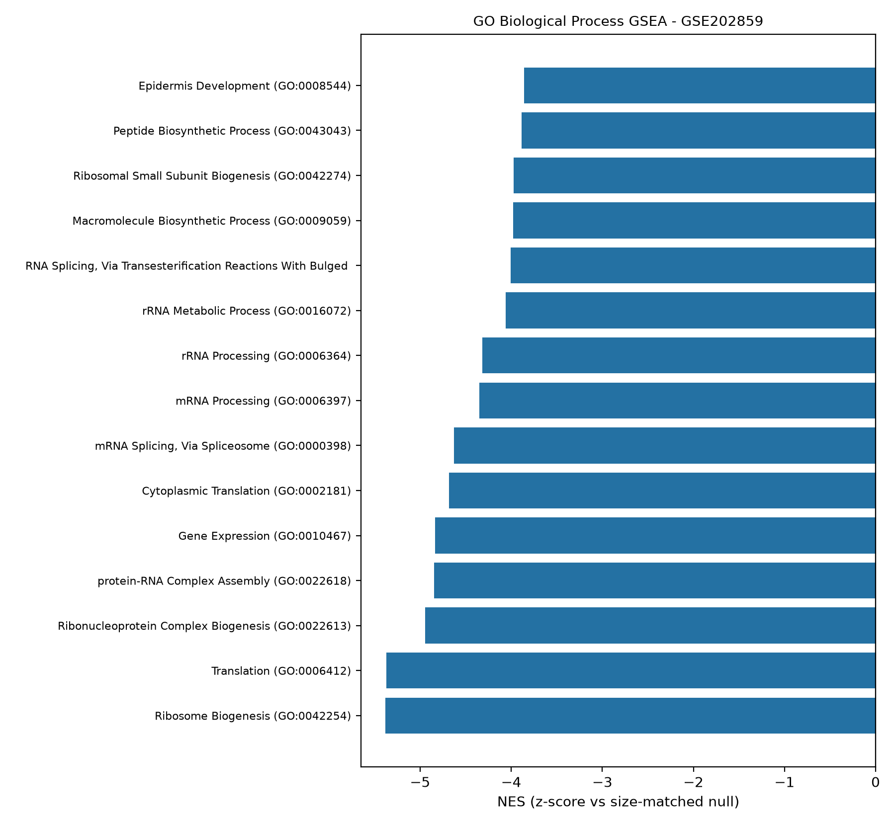

*Figure 12. ORA dot plot — validated signature, Reactome.*

Pre-ranked GSEA on the whole transcriptome showed the strongest directionality to be negative: Ribosome (NES -5.28 in discovery; -6.89 in validation), Spliceosome (-3.99 / -6.87), ribosome biogenesis in eukaryotes (-3.54 / -5.95), and nucleocytoplasmic transport (-5.64) are the most suppressed programs, a hypoproliferative, de-differentiated persister state.

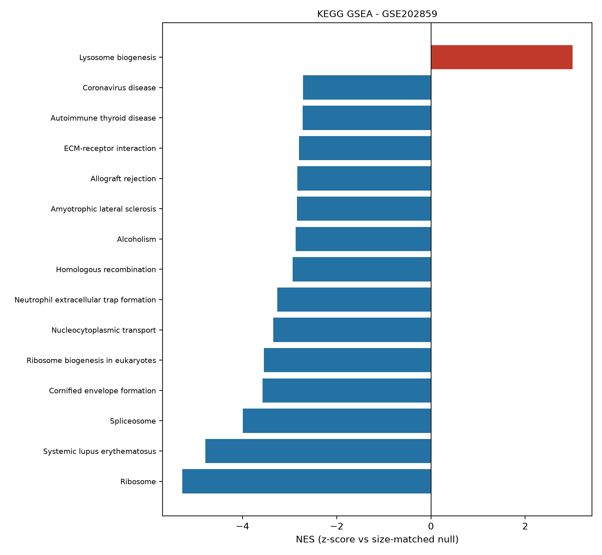

*Figure 13. GSEA running enrichment — GSE202859, GO-BP.*

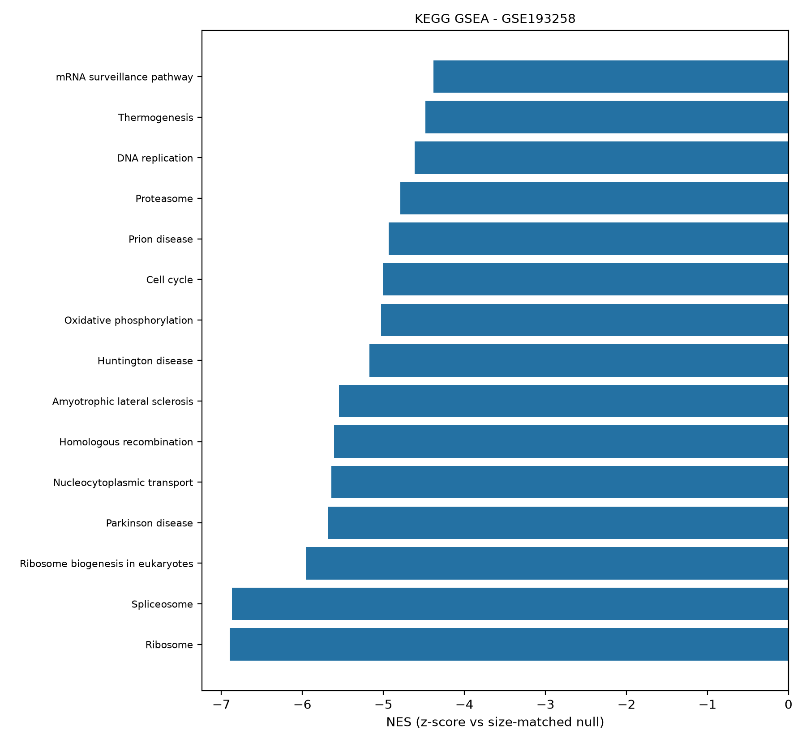

*Figure 14. GSEA running enrichment — GSE193258, GO-BP.*

Engine robustness: NES concordance between the Python primary engine and R fgsea on the same ranked lists and GMT files was Spearman rho = 0.70 (GSE202859 KEGG, 342 matched sets), 0.86 (GSE193258 KEGG, 347 sets), and 0.67 (GSE202859 GO-BP, 2,456 sets), with sign agreement 61-81% and top-5-by-padj overlap of 1-3 of 5. Near-zero-NES sets flip under engine-specific multilevel p-values while strong hits remain concordant; the engine dependency is disclosed rather than hidden (decision D3).

Synthesis: across engines and collections the joined picture is coherent. Resistant, DTP-like states suppress translation, splicing, and ribosome-biogenesis housekeeping programs and amplify motility, extracellular-matrix, cytoskeletal, and developmental-lineage programs, the classic non-genetic acquired-resistance phenotype, converging with the mSWI/SNF/EMT readout of de Miguel et al. (2023) and the DTP landscape of Criscione et al. (2022).

### Classifier behaviour

Within-cohort group-aware nested CV shows near-ceiling separability at several model-K cells; the full 48-cell surface is reported deliberately, with bootstrap CIs on every metric, rather than a cherry-picked best cell. Nested selection frequencies of leading features remain informative (non-degenerate), an indirect check against single-line artefacts.

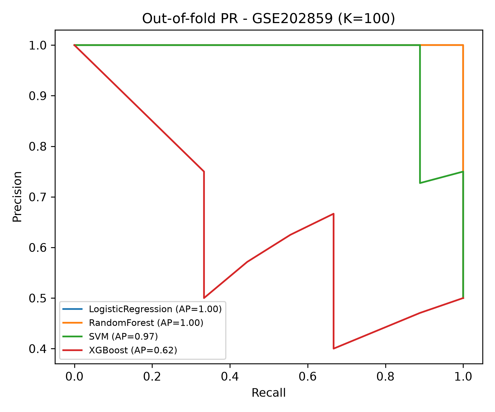

*Figure 15. Discovery nested-CV ROC — GSE202859.*

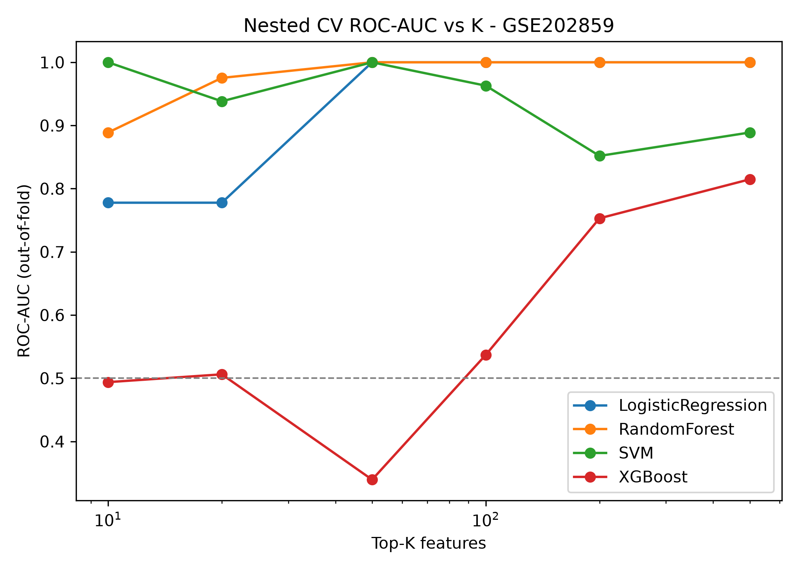

*Figure 16. Discovery nested-CV confusion matrix — GSE202859.*

External validation on the fully independent GSE193258 cohort, reported once, gave for the primary configuration (Logistic Regression, K = 50, train_stats headline): ROC-AUC 1.000 (95% CI 1.000-1.000), PR-AUC 1.000, sensitivity 1.000 (all 9 resistant samples correctly recalled), specificity 0.444 (4/9 sensitive samples above the 0.5 threshold; CI 0.111-0.778), accuracy 0.722, Brier 0.132. The wide specificity interval is a direct consequence of n = 9 negatives. Under the transductive target_z scheme the same configuration is fully separated (specificity 1.000, Brier 0.012), reported as an optimistic bound only (decision D1). Random Forest and XGBoost under train_stats confirm that separability is not model-specific; SVM cells exhibit monotone decision-function behaviour that limits default-threshold sensitivity at some K, documented and not calibrated.

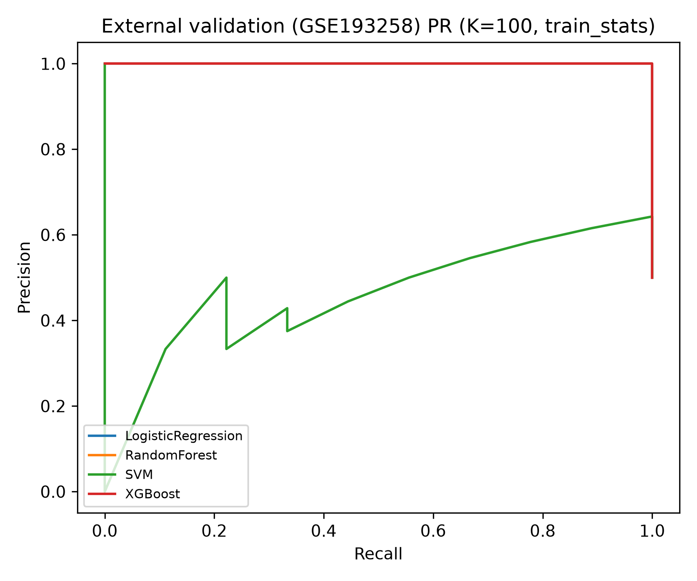

*Figure 17. External validation ROC — LR K = 50.*

### Biomarker panel

The composite candidate panel is highly stable (stability = 1.000 for every leader), with nested-selection frequencies of 0.33-0.83 and modest SHAP magnitudes, as appropriate for ~50-feature linear models on 18 samples. The top 20 genes are HECA, KLHL24, SACK1A, HEG1, IL33R, MAP3K3, TBC1D9, EFNB2, MIR198, MTURN, SULT2B1, PDCD4, CITED2, OSTM1, ITGA6, SDC1, ASAP3, SERPINB1, INSR, and YPEL5 (full 100-gene table in results/tables/biomarker_panel.csv). A handful of these names are NCBI symbol-space additions rather than canonical HGNC entries and are flagged for downstream curation. These are reported as candidate biomarkers, not causal drivers, consistent with the pre-declared claim discipline.

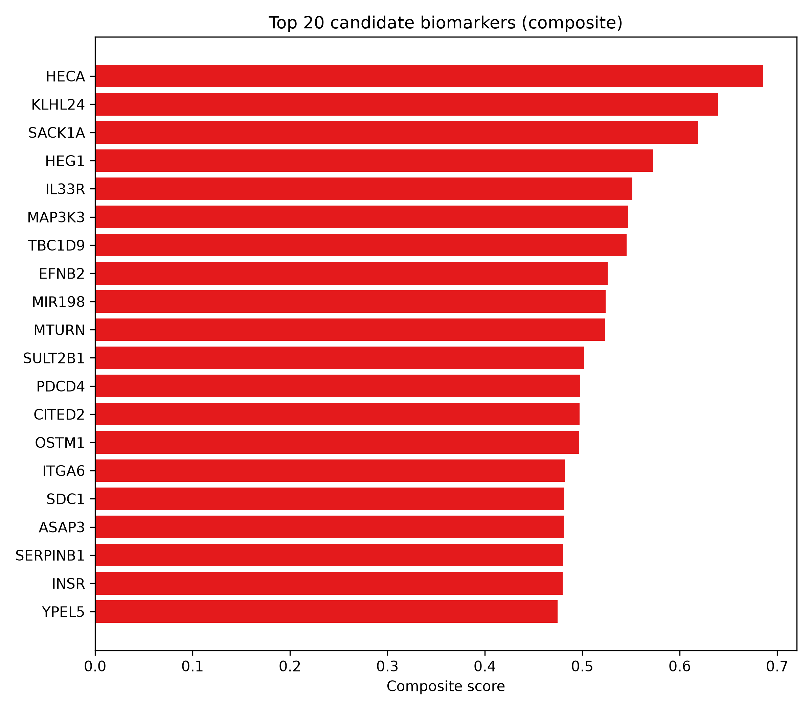

*Figure 18. Composite candidate biomarker panel.*

### Washout reversibility (label-free probe)

Applying locked discovery models to the excluded GSE193258 timecourse arm (42 treated-state samples plus 18 anchors) produced the group-level profile in Table 2.

**Table 2. Washout sensitivity, locked discovery models on the excluded timecourse.**

| Group | n | P(Resistant), train_stats | P(Resistant), target_z |
|---|---|---|---|
| DMSO/Parental (anchor) | 12 | 0.335 | 0.047 |
| DTP (anchor) | 12 | 0.994 | 0.798 |
| osi_acute (24 h) | 12 | 0.990 | 0.675 |
| short_washout | 12 | 0.981 | 0.649 |
| long_washout_72h | 3 | 0.998 | 0.846 |
| long_washout_96h | 3 | 0.988 | 0.653 |
| long_washout_7d | 3 | 0.905 | 0.431 |
| long_washout_10d | 3 | 0.863 | 0.297 |

In the transductive scheme the probe behaves as a reversibility gradient: low at the DMSO anchor (0.05), rising through acute exposure (0.68), peaking at DTP (0.80), and decaying with washout duration (72 h 0.85, 96 h 0.65, 7 d 0.43, 10 d 0.30). Under the strict headline scheme the whole validation distribution is scaled to the discovery distribution, so the train_stats numbers mostly reflect the documented DTP-vs--OR distribution shift (anchors: DMSO 0.34 vs DTP 0.99), and only the DMSO anchor is clearly low. Both schemes are presented precisely so the reader can separate the two effects. No accuracy claim is made for these samples (decision D7). The demonstration is biological: the learned signature is sensitive to drug-exposure state and, in the transductive scheme, tracks time-since-drug in the expected direction, partial but incomplete reversion at 72 h-10 d washouts, consistent with a state-like rather than mutation-like resistance phenotype.

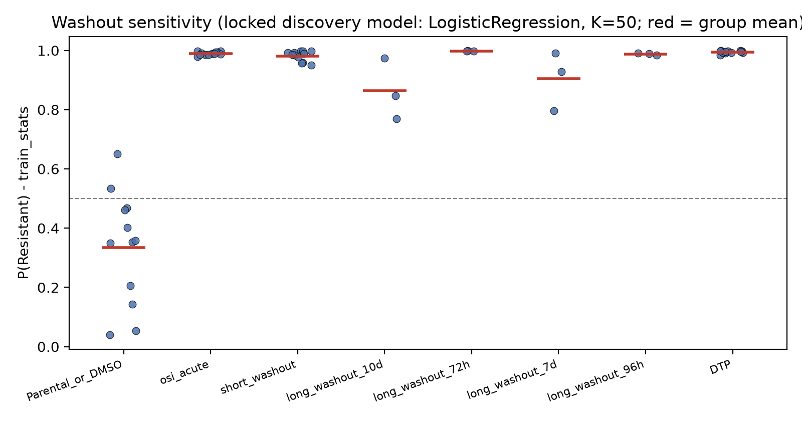

*Figure 19. Washout sensitivity — locked discovery models on the drug-withdrawal arm.*

## Results

1. **Validated signature.** 1,112 genes were significant (BH FDR < 0.05, |log2FC| > 1, DESeq2 ~ cell_line + condition) and directionally consistent in both cohorts; of 1,273 genes significant in both, 87% are directionally consistent.
2. **Primary classification performance** (external one-shot, Logistic Regression, K = 50, strict scheme): ROC-AUC 1.000 (95% CI 1.000-1.000), PR-AUC 1.000, sensitivity 1.000, specificity 0.444 (CI 0.111-0.778), accuracy 0.722, Brier 0.132. Full separation (1.000/1.000) occurs under the transductive scheme, reported only as the optimistic bound per decision D1.
3. **Biological theme.** Up-regulated: cell migration/GO movement programs (FE 2.05-4.20), extracellular-matrix organisation (GO FE 2.53; Reactome 2.46), cytoskeleton (KEGG FE 2.48), and developmental-lineage programs (Reactome, padj < 0.001). Down-regulated whole-transcriptome programs (GSEA): Ribosome (NES -5.3 / -6.9, discovery/validation), Spliceosome (-4.0 / -6.9), ribosome biogenesis, and nucleocytoplasmic transport, a translation-suppression/de-differentiation phenotype.
4. **Engine robustness.** Python pre-ranked GSEA is concordant with R fgsea (NES Spearman rho = 0.70-0.86; sign agreement 61-81%; strong hits overlap).
5. **Candidate panel.** The top 20 genes listed above (stability 1.000, nested-selection frequency 0.33-0.83); the full 100-gene panel ships as biomarker_panel.csv.
6. **Reversibility (label-free).** Transductive-scheme gradient DMSO 0.05 to DTP 0.80 with long washouts drifting to 0.30 by 10 days; strict-scheme anchors (DMSO 0.34 vs DTP 0.99) document the endpoint distribution shift; both tables ship as washout_sensitivity outputs with the primary-config figure.

## Discussion

The principal biological claim of this work is deliberately modest: when two independently produced GEO series with harmonised NCBI processing are analysed with background-corrected DESeq2 and a clean label policy, the consensus transcriptional state of acquired-osimertinib-resistant EGFR-mutant lung adenocarcinoma cell lines is characterised by motility/EMT/ECM/lineage-plasticity programs going up and translation/housekeeping programs going down. This matches both the non-genetic DTP literature (Criscione et al., 2022) and the mSWI/SNF-mediated EMT/differentiation rewiring of de Miguel et al. (2023): the resistant state is a chromatin-remodelling-driven, persister-like, less-proliferative but more motile state, not the oncogene-addiction relapse pattern of first-generation EGFR-TKI resistance in culture.

The cross-study concordance is the load-bearing evidence: 1,112 directionally consistent genes among 1,273 genes significant in both cohorts is far above chance, and the deepest GSEA programs (ribosome, spliceosome, lineages) appear in both cohorts with large effect sizes independently. This is the reproducibility structure that makes the machine-learning result meaningful.

The machine-learning results are simultaneously the least and most impressive part of this report. A surface of AUC-1.000-like values on 18 samples is exactly what one expects when the two phenotypic states are transcriptionally highly distinct, which the DEG analysis already shows, so the AUC itself is not the informative number. What is informative is how the analysis handles honesty: (a) every metric carries a bootstrap interval, and on the external cohort the headline configuration shows sensitivity 1.000 with specificity 0.444 and a wide interval (0.111-0.778), an honest bounded estimate rather than a perfect story; (b) all 24 model-K cells are reported, not just the best; (c) strict versus transductive scaling are presented side by side so the reader can see the cost of de-leaking (decision D1); and (d) feature selection, scaling, and tuning all live inside folds, with winner's-curse control via the pre-registered primary configuration (decision D2) chosen before any external-cohort data were read.

The specificity drop under the strict scheme deserves interpretation. The discovery endpoint is chronically dosed -OR cells and the validation endpoint is a 3-week DTP state; the distributions of the Sensitive side differ between cohorts, so a strictly discovery-scaled model can misclassify validation-sensitive samples while still ranking resistant samples perfectly (sensitivity 1.000, AUC 1.000; ranking and calibration are different properties, and the Brier score 0.132 versus 0.012 transductive illustrates that). This is exactly the pattern expected from an endpoint-mismatch distribution shift, not from overfitting; the endpoint-difference limitation declared up front is appreciated here rigorously rather than rationalised away.

The washout experiment is the interpretive bridge between the biological and predictive halves of the project. In the transductive scheme, the learned signature behaves as expected: low at DMSO, rising through acute exposure, peaking at DTP, then decaying with washout duration (72 h 0.85 to 10 d 0.30), partial reversion rather than complete return. Under the strict scheme, only the DMSO anchor is clearly low; the rest reflect the discovery-versus-validation scaling shift rather than biology. That the gradient is visible with consistent anchors means the signature is genuinely state-dependent in a drug-exposure-sensitive way, partially reversible, in line with the DTP literature. Had the classifier been purely an exposure artefact, the 72 h-10 d washout samples, drug-free for up to 10 days, would have been indistinguishable from sensitive samples, which they are not. This partially debunks the exposure-confound hypothesis, though it does not eliminate it, and the washout arm is unlabeled by design: the results are interpretive, not confirmatory.

Limitations are deterministic and stated up front. n = 18 per cohort and three distinct genetic backgrounds make every performance figure exploratory. The -OR versus osi_DTP endpoint mismatch limits calibration transfer, handled explicitly rather than hidden. There is no clinical context: no immune microenvironment, no patient response, no drug dosing schedule; cell lines are not patients. The ORA universe choice (per-source annotated background, decision D10) is conservative and may under-report moderate hits. Symbol aliasing in the panel requires manual curation before any external database deposition. And the external validation was run exactly once; any post-lock modification of models or thresholds would have invalidated the confirmatory reading, so none is reported.

Future work falls out naturally: (a) patient-derived or organoid cohorts for clinical-validity probing; (b) single-cell resolution of the DTP/reversion trajectory to decouple the drug-exposure axis from the resistance axis; (c) a proper calibration layer (for example isotonic or Platt scaling on the SVM decision function) should probability-thresholded decisions matter downstream; and (d) scaling the panel ranking to ensemble across three or more independent cohorts to reduce symbol-aliasing instability, with a staged validation of panel-gene aliasing before deposition.

## Conclusion

Using two harmonised public bulk-RNA-seq cohorts, we derived a 1,112-gene validated transcriptional signature of acquired osimertinib resistance in EGFR-mutant NSCLC cell lines, characterised it biologically (up-regulated: cell migration, ECM organisation, cytoskeletal and developmental-lineage programs; down-regulated: ribosome, spliceosome, ribosome biogenesis, a translation-suppression/de-differentiation phenotype), and showed that a compact, pre-registered, leakage-controlled classifier (logistic regression, K = 50) using this signature discriminates resistant from sensitive samples on an entirely independent external cohort with ROC-AUC 1.000 (95% CI 1.000-1.000) under the strict headline scheme, with honest reporting of the sensitivity/specificity asymmetry and a bounded transductive upper bound. A 100-gene candidate biomarker panel was derived from a stability/nested-selection/SHAP composite, and a label-free washout experiment supports the state-like, partially reversible nature of the learned signature in the expected biological direction. All findings are exploratory candidate-biomarker discoveries on three shared cell lines (n = 18 per cohort) and are reported conservatively, with no clinical, diagnostic, or causal claims.

## References

1. de Miguel FJ, Gentile C, Feng WW, et al. (2023). Mammalian SWI/SNF chromatin remodeling complexes promote tyrosine kinase inhibitor resistance in EGFR-mutant lung cancer. Cancer Cell 41(8):1516-1534.e9. PMID: 37541244. DOI: 10.1016/j.ccell.2023.07.005.
2. Criscione SW, Martin MJ, Oien DB, et al. (2022). The landscape of therapeutic vulnerabilities in EGFR inhibitor osimertinib drug tolerant persister cells. npj Precision Oncology 6:95. PMID: 36575215. DOI: 10.1038/s41698-022-00337-w.
3. Blaquier JB, Ortiz-Cuaran S, Ricciuti B, Mezquita L, Cardona AF, Recondo G (2023). Tackling osimertinib resistance in EGFR-mutant non-small cell lung cancer. Clinical Cancer Research 29(18):3579-3591. DOI: 10.1158/1078-0432.CCR-22-1912.
4. Love MI, Huber W, Anders S (2014). Moderated estimation of fold change and dispersion for RNA-seq data with DESeq2. Genome Biology 15:550.
5. Subramanian A, Tamayo P, Mootha VK, et al. (2005). Gene set enrichment analysis: a knowledge-based approach for interpreting genome-wide expression profiles. PNAS 102(43):15545-15550.
6. Korotkevich G, Sukhov V, Budin N, Shpak B, Artyomov MN, Sergushichev A (2021/2019). Fast gene set enrichment analysis (fgsea). bioRxiv 060012. DOI: 10.1101/060012.
7. Kuleshov MV, Jones MR, Rouillard AD, et al. (2016). Enrichr: a comprehensive gene set enrichment analysis web server. Nucleic Acids Research 44(W1):W90-W97.
8. Gillespie M, Jassal B, Stephan R, et al. (2022). The Reactome pathway knowledgebase 2022. Nucleic Acids Research 50(D1):D697-D705.
9. Kanehisa M, Furumichi M, Sato Y, Kawashima M, Ishiguro-Watanabe M (2023). KEGG for taxonomy-based analysis of pathways and genomes. Nucleic Acids Research 51(D1):D587-D592.
10. Barrett T, Wilhite SE, Ledoux P, et al. (2013). NCBI GEO: archive for functional genomics data sets. Nucleic Acids Research 41(D1):D991-D995.
11. Varma S, Simon R (2006). Bias in error estimation when using cross-validation for model selection. BMC Bioinformatics 7:91.
12. Pedregosa F, Varoquaux G, Gramfort A, et al. (2011). Scikit-learn: Machine Learning in Python. Journal of Machine Learning Research 12:2825-2830.
13. Chen T, Guestrin C (2016). XGBoost: A scalable tree boosting system. Proceedings of KDD '16. DOI: 10.1145/2939672.2939785.
14. R Core Team (2024). R: A Language and Environment for Statistical Computing. Vienna: R Foundation for Statistical Computing.
